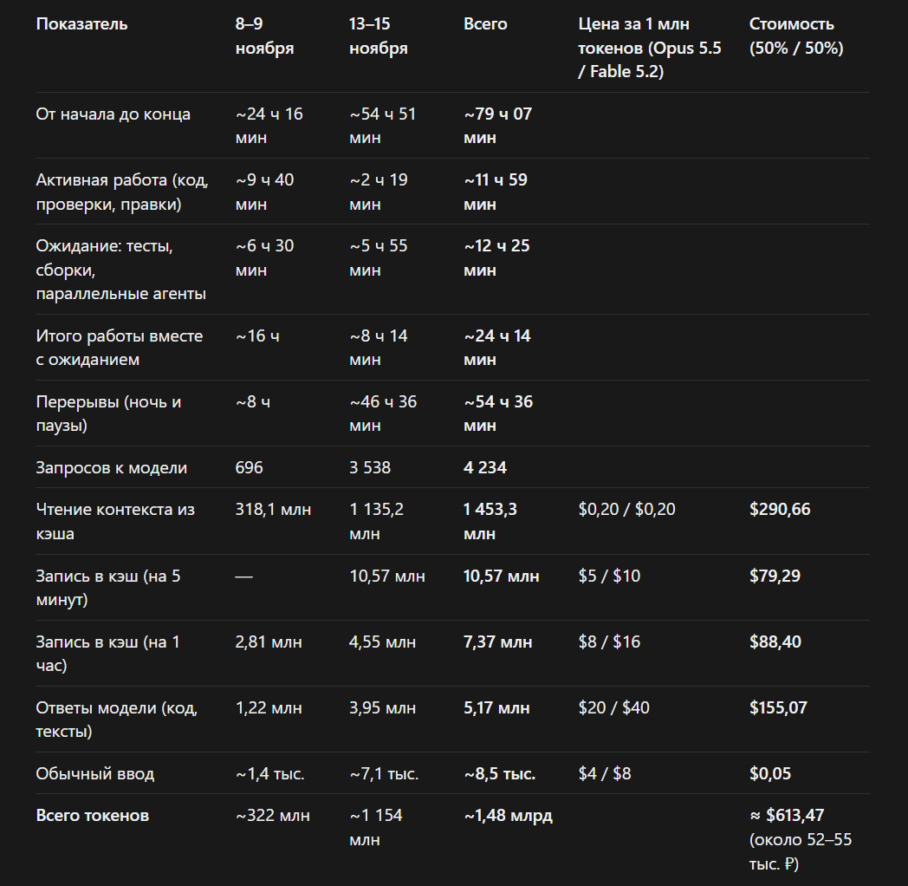

# Затраты на создание / Cost of creation

🇷🇺 [Русский](#русский) · 🇬🇧 [English](#english)

## Русский

Игра сделана с помощью Claude Code. **Половину работы выполнил Claude Opus 5.5, половину — Claude Fable 5.2** (режим Ultracode).
Стоимость поделена поровну: 50% по ценам Opus 5.5 и 50% по ценам Fable 5.2.

| Показатель | 8–9 ноября | 13–15 ноября | Всего | Цена за 1 млн токенов (Opus 5.5 / Fable 5.2) | Стоимость (50% / 50%) |
|---|---|---|---|---|---|
| От начала до конца | ~24 ч 16 мин | ~54 ч 51 мин | **~79 ч 07 мин** | | |
| Активная работа (код, проверки, правки) | ~9 ч 40 мин | ~2 ч 19 мин | **~11 ч 59 мин** | | |
| Ожидание: тесты, сборки, параллельные агенты | ~6 ч 30 мин | ~5 ч 55 мин | **~12 ч 25 мин** | | |
| Итого работы вместе с ожиданием | ~16 ч | ~8 ч 14 мин | **~24 ч 14 мин** | | |
| Перерывы (ночь и паузы) | ~8 ч | ~46 ч 36 мин | **~54 ч 36 мин** | | |
| Запросов к модели | 696 | 3 538 | **4 234** | | |
| Чтение контекста из кэша | 318,1 млн | 1 135,2 млн | **1 453,3 млн** | $0,20 / $0,20 | **$290,66** |
| Запись в кэш (на 5 минут) | — | 10,57 млн | **10,57 млн** | $5 / $10 | **$79,29** |
| Запись в кэш (на 1 час) | 2,81 млн | 4,55 млн | **7,37 млн** | $8 / $16 | **$88,40** |
| Ответы модели (код, тексты) | 1,22 млн | 3,95 млн | **5,17 млн** | $20 / $40 | **$155,07** |
| Обычный ввод | ~1,4 тыс. | ~7,1 тыс. | **~8,5 тыс.** | $4 / $8 | **$0,05** |
| Всего токенов | ~322 млн | ~1 154 млн | **~1,48 млрд** | | **≈ $613,47** (около 52–55 тыс. ₽) |

## English

The game was built with Claude Code. **Half of the work was done by Claude Opus 5.5 and half by Claude Fable 5.2** (Ultracode mode).
The cost is split evenly: 50% at Opus 5.5 prices and 50% at Fable 5.2 prices.

| Metric | Nov 8–9 | Nov 13–15 | Total | Price per 1M tokens (Opus 5.5 / Fable 5.2) | Cost (50% / 50%) |
|---|---|---|---|---|---|
| Start to finish | ~24 h 16 min | ~54 h 51 min | **~79 h 07 min** | | |
| Active work (code, checks, fixes) | ~9 h 40 min | ~2 h 19 min | **~11 h 59 min** | | |
| Waiting: tests, builds, parallel agents | ~6 h 30 min | ~5 h 55 min | **~12 h 25 min** | | |
| Total work including waiting | ~16 h | ~8 h 14 min | **~24 h 14 min** | | |
| Breaks (nights and pauses) | ~8 h | ~46 h 36 min | **~54 h 36 min** | | |
| Model requests | 696 | 3,538 | **4,234** | | |
| Context read from cache | 318.1M | 1,135.2M | **1,453.3M** | $0.20 / $0.20 | **$290.66** |
| Cache write (5 minutes) | — | 10.57M | **10.57M** | $5 / $10 | **$79.29** |
| Cache write (1 hour) | 2.81M | 4.55M | **7.37M** | $8 / $16 | **$88.40** |
| Model output (code, text) | 1.22M | 3.95M | **5.17M** | $20 / $40 | **$155.07** |
| Regular input | ~1.4K | ~7.1K | **~8.5K** | $4 / $8 | **$0.05** |
| Total tokens | ~322M | ~1,154M | **~1.48B** | | **≈ $613.47** (about 52–55K RUB) |
